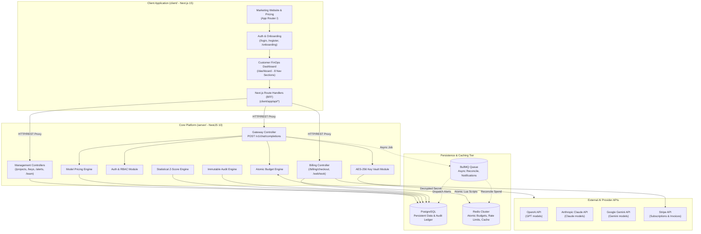
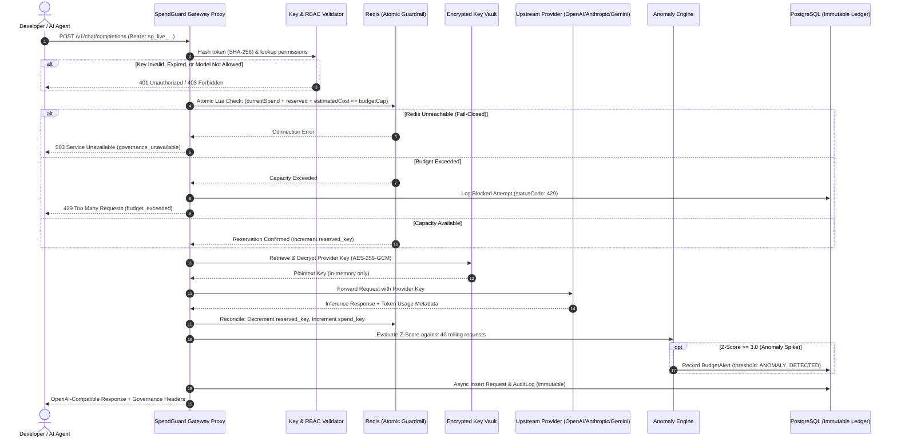
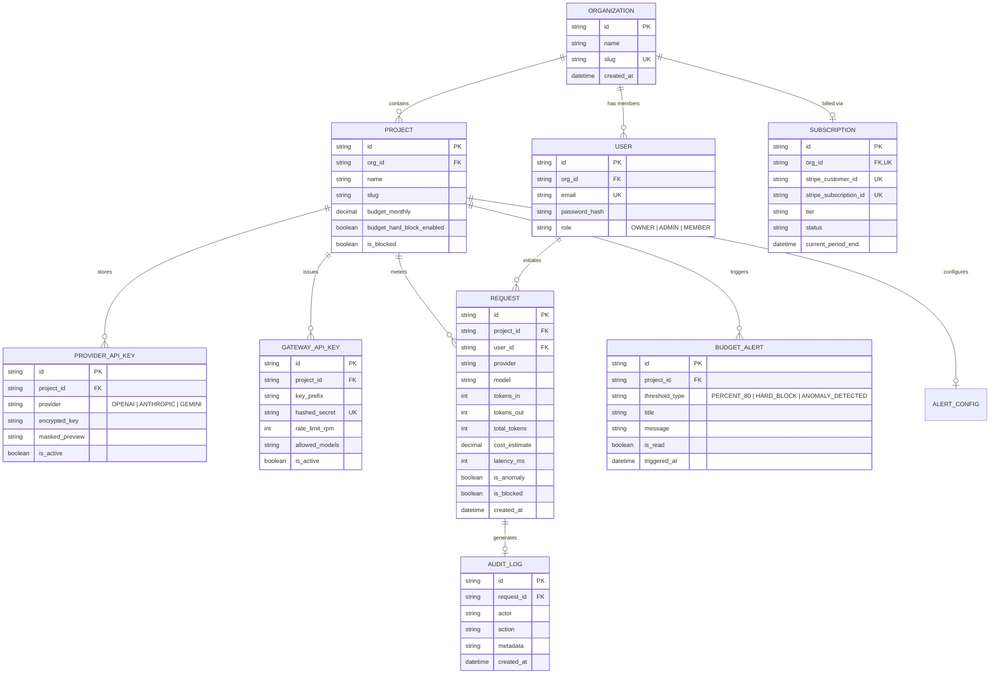
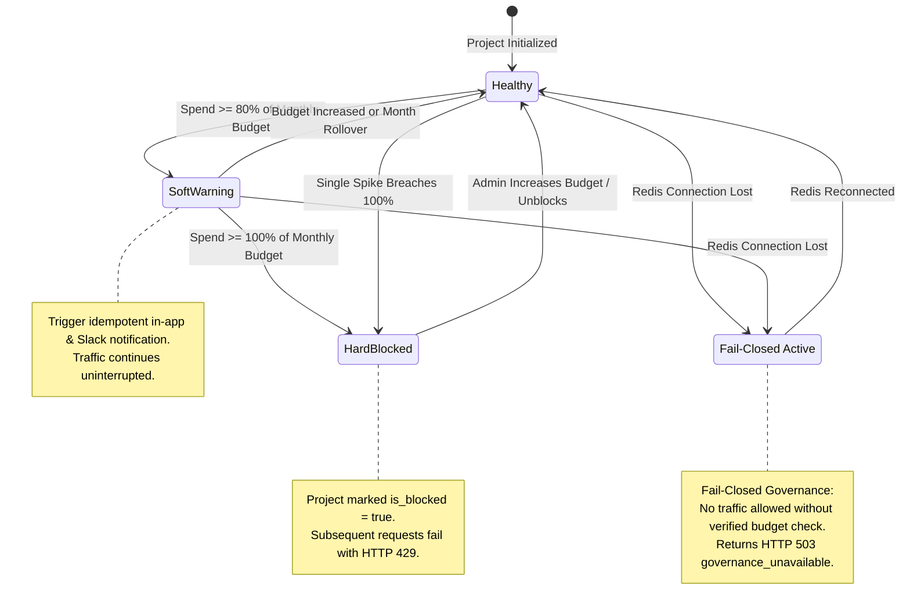

# SpendGuard AI — Production System Architecture & Design Specification (Phase 0)

**Version**: 2.0.0-PROD  
**Date**: 2026-11-09  
**Target**: Commercial Multi-Tenant AI Spend Governance Platform  

---

## 1. System Topology & Monorepo Architecture

SpendGuard AI is architected as a high-performance **modular monolith** with clean client/server separation:

---

## 2. End-to-End Request Lifecycle (AI Gateway)

Every inference call through the unified endpoint `POST /v1/chat/completions` undergoes strict pre-flight governance, atomic reservation, upstream dispatch, and post-flight reconciliation:

---

## 3. Security & Cryptographic Architecture

### 3.1 Two-Tier Envelope Encryption (Provider Keys)
External provider credentials (e.g. OpenAI `sk-...`, Anthropic `sk-ant-...`, Gemini keys) are secured using envelope encryption to prevent exposure even in the event of database exfiltration:
- **Master Encryption Key (`ENCRYPTION_MASTER_KEY`)**: 32-byte secret sourced exclusively from environment variables or AWS Secrets Manager. Never stored in the database.
- **Data Key & Payload**:
  1. Generate 16-byte cryptographically secure random IV: `crypto.randomBytes(16)`.
  2. Encrypt plaintext provider key with AES-256-GCM.
  3. Obtain 16-byte authentication tag: `cipher.getAuthTag()`.
  4. Serialized format: `env:v1:<iv>:<authTag>:<encryptedPayload>`.
- **Zero Plaintext Exposure**: Plaintext keys are decrypted only in-memory at the moment of provider dispatch. API endpoints return only the sanitized `maskedPreview` (`sk-...7890`).

### 3.2 Gateway Virtual Keys (`sg_live_*`, `sg_test_*`)
Customer-facing SpendGuard keys are generated with secure random entropy:
- `secret`: `sg_live_` + 32-byte hex string (displayed to customer **exactly once** upon creation).
- `keyPrefix`: `sg_live_` + first 4 characters.
- `hashedSecret`: `crypto.createHmac('sha256', PEPPER).update(secret).digest('hex')`.
- The database stores **only** `hashedSecret`. Even with full read access to PostgreSQL, no active gateway keys can be reconstructed.

### 3.3 User Password Security
- User passwords are salted with 32 random bytes and hashed via **PBKDF2-HMAC-SHA512** (100,000 iterations), formatted as `$pbkdf2$<salt>$<hash>`.

---

## 4. Multi-Tenant Data Model (PostgreSQL / Prisma)

---

## 5. Budget State Machine & Guardrail Policies

---

## 6. Billing Domain Isolation Architecture

To ensure platform reliability and zero cross-contamination:
- **No Shared Services**: `BillingService` and `BillingController` operate in an independent domain from `GatewayService` and `PricingService`.
- **Database Boundary**: `Subscription` links strictly to `Organization` via `orgId`. It contains **no foreign keys or queries** into `Request`, `ModelPricing`, or `ProviderApiKey`.
- **Failure Isolation**: A Stripe API outage or webhook delay will **never impact LLM inference latency** or block API proxy traffic.

---

## 7. Production Deployment Specification

| Service Layer | Technology | Recommended Cloud Target | Sizing / Redundancy |
|---|---|---|---|
| **Frontend / BFF** | Next.js 15 App Router | Vercel Enterprise | Global Edge Network, multi-region failover |
| **API Gateway Core** | NestJS 10 (Docker) | AWS ECS Fargate / GCP Cloud Run | Min 2 replicas, autoscaling on CPU/Latency |
| **Background Worker** | NestJS BullMQ Worker | AWS ECS Fargate (Worker process) | 1-2 worker tasks independent of API |
| **Relational Database**| PostgreSQL 16 | Neon / AWS RDS Aurora PostgreSQL | Multi-AZ, automated daily snapshots |
| **Budget & Rate Cache**| Redis 7.2 | Upstash Redis / AWS ElastiCache | In-memory persistence, sub-5ms latency SLA |
| **Object Storage** | AWS S3 Compatible | Cloudflare R2 / AWS S3 | Encrypted audit log CSV exports |
| **Ingress & Security** | Cloudflare | Cloudflare Enterprise | DDoS protection, TLS 1.3, strict rate limiting |

