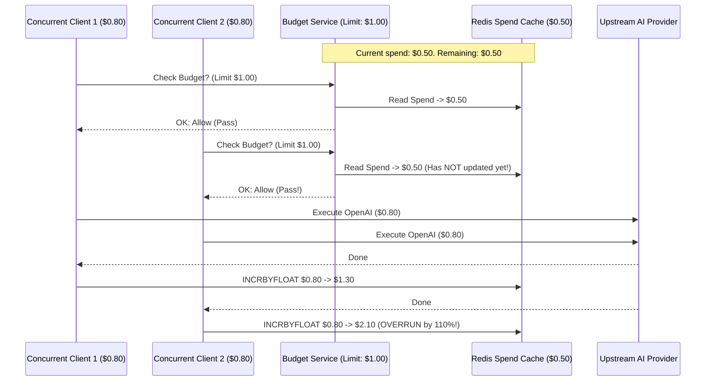
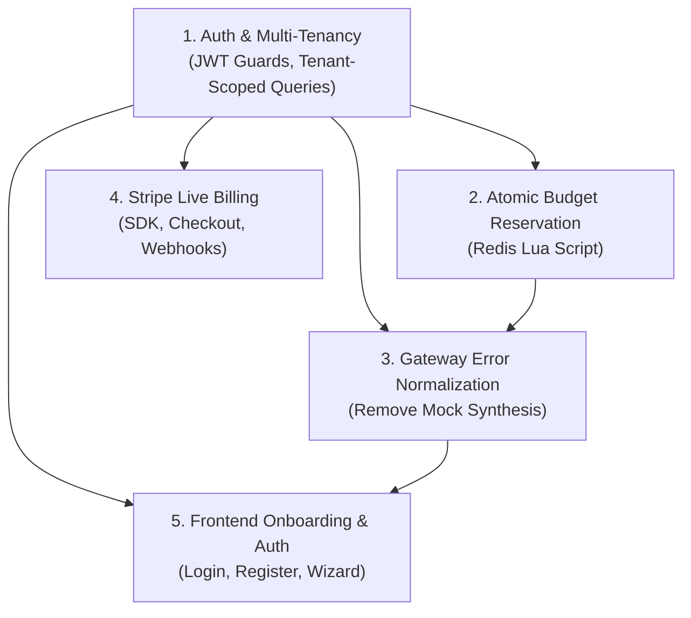

# SpendGuard AI — Production Gap Analysis & Remediation Plan (Phase 0)

**Date**: 2026-11-09  
**Auditor**: Principal Systems Architect  
**Objective**: Identify every engineering gap preventing SpendGuard AI from operating as a production commercial SaaS, and specify the exact technical remediation.

---

## Gap 1: Multi-Tenancy & Authorization Security (Critical)

### 1.1 The Gap
Although `server/src/modules/auth/` contains comprehensive JWT infrastructure (`JwtService`, `jwt.strategy.ts`, `jwt-auth.guard.ts`, `roles.guard.ts`), **no controllers in `server/src/modules/` currently enforce authentication**.
Furthermore, multiple service methods fall back to querying the first organization in the database:
- `OrganizationsService.listProjects()` (line 30): Returns all projects without tenant filtering when `orgId` is omitted.
- `OrganizationsService.createProject()` (line 92): `let org = await this.prisma.organization.findFirst();`
- `TeamService.listMembers()` (line 11): `const org = await this.prisma.organization.findFirst();`
- `TeamService.inviteMember()` (line 34): `let org = await this.prisma.organization.findFirst();`
- `TeamService.inviteMember()` (line 46): `passwordHash: '$argon2id$mock-hash-for-demo'`

### 1.2 The Risk
In a multi-tenant cloud environment, any unauthenticated user or Tenant B can read, modify, or delete Tenant A's projects, budgets, keys, and audit logs. A user can create a project and it will be assigned to whichever customer registered first in the database.

### 1.3 Remediation Specification
1. **Apply `@UseGuards(JwtAuthGuard, RolesGuard)`**:
   - Annotate `OrganizationsController`, `KeysController`, `TeamController`, `AlertsController`, `AnalyticsController`, and `AuditController`.
2. **Inject Current User & Organization**:
   - Create a `@CurrentUser()` custom param decorator extracting `{ userId, orgId, role }` from `req.user`.
3. **Strict Query Scoping**:
   - Every database query must strictly filter by `where: { orgId: user.orgId }` (or `projectId IN (SELECT id FROM projects WHERE orgId = user.orgId)`).
4. **Build Missing Customer UI Pages**:
   - Implement `client/app/login/page.tsx` and `client/app/register/page.tsx` wired to `/api/auth/login` and `/api/auth/register`.
   - Store JWT securely in HTTP-only cookies or NextAuth session.
   - Redirect unauthenticated dashboard visitors to `/login`.

---

## Gap 2: AI Gateway Concurrency & Atomic Budget Reservation (Critical)

### 2.1 The Gap
Currently, `BudgetService.checkBudgetGuardrail(projectId)` queries Redis/Postgres for `currentMonthlySpend` *before* the request is sent, and `GatewayService` increments spend in Redis *after* the request completes.



### 2.2 The Risk
Under concurrent traffic spikes or automated background workflows (e.g. 50 parallel agents), dozens of requests can pass the budget guardrail simultaneously before any single request writes back its cost. This violates the platform's core commercial promise: **guaranteed spend control**.

### 2.3 Remediation Specification
Implement an **Atomic Redis Reservation Engine** using an atomic Lua script:
1. **Estimate Maximum Cost**: Before dispatching, calculate `maxEstimatedCost = (promptTokens * inputRate) + (maxTokens * outputRate)`.
2. **Atomic Reserve Script**:
   ```lua
   -- KEYS[1]: spend_key, KEYS[2]: reserved_key
   -- ARGV[1]: estimated_amount, ARGV[2]: budget_cap
   local current_spend = tonumber(redis.call('get', KEYS[1]) or '0')
   local current_reserved = tonumber(redis.call('get', KEYS[2]) or '0')
   local estimated = tonumber(ARGV[1])
   local cap = tonumber(ARGV[2])

   if (current_spend + current_reserved + estimated) > cap then
       return {0, current_spend, current_reserved} -- REJECT: Budget exceeded
   else
       redis.call('incrbyfloat', KEYS[2], estimated)
       redis.call('expire', KEYS[2], 300) -- Auto-expire stranded reservations after 5 min
       return {1, current_spend, current_reserved + estimated} -- ACCEPT: Reserved
   end
   ```
3. **Reconcile Actual Usage**: Once the upstream provider returns actual token usage:
   - Atomically decrement `reserved_key` by `maxEstimatedCost`.
   - Increment `spend_key` by `actualCost`.
4. **Failure Recovery**: If upstream fails or times out, immediately release the reserved amount.

---

## Gap 3: AI Gateway Error Normalization & Mock Fallbacks (High)

### 3.1 The Gap
In `OpenAIAdapter`, `AnthropicAdapter`, and `GeminiAdapter`, when no key is configured or when the upstream API returns an error (401, 429, 500), the adapter logs a warning and returns synthetic text:
```typescript
const responseText = `[SpendGuard Proxy: ${req.model}]\n\nProcessed inference for query...`;
return { responseText, promptTokens, completionTokens, isSimulated: true };
```
Additionally, `GatewayController` (line 154) allows requests without an API key to execute against the first active project in the database.

### 3.2 The Risk
Customers using SpendGuard as a commercial drop-in replacement for OpenAI SDK receive fake responses instead of real provider errors when their upstream keys expire or fail. Furthermore, unauthorized public requests consume project budgets.

### 3.3 Remediation Specification
1. **Enforce Gateway Key Requirement**: If `Authorization: Bearer <key>` is missing or invalid, immediately return HTTP 401 `invalid_api_key`. Never fall back to `proj_copilot` or random database projects.
2. **Remove Synthetic Mock Fallbacks**:
   - If a provider API key is not configured for the project, return HTTP 400 `provider_key_not_configured`.
   - If the upstream provider returns an error (e.g. OpenAI 429 or 503), normalize and forward the real status code and error message.
3. **Streaming Token Accounting**:
   - Implement SSE streaming pipeline (`res.setHeader('Content-Type', 'text/event-stream')`).
   - Parse provider usage chunks (e.g. OpenAI `stream_options: { include_usage: true }`), reconcile the Redis reservation when the stream closes, and persist the final `Request` row.

---

## 4. Gap 4: Platform Billing (Stripe) Production Integration (High)

### 4.1 The Gap
- The `stripe` npm library is not installed in `server/`.
- `BillingService.createCheckoutSession()` has real Stripe calls commented out, returning a stub URL.
- `BillingService.handleWebhook()` returns `{ received: true, isStub: true }` without signature verification.
- Subscription status in PostgreSQL is not linked to gateway feature gating (entitlements).

### 4.2 The Risk
SpendGuard cannot accept customer payments, cannot provision paid plans (Starter $39 / Growth $199), and cannot handle cancellations or failed invoices.

### 4.3 Remediation Specification
1. **Install and Configure Stripe**:
   - Run `npm install stripe` in `server/`.
   - Instantiate `new Stripe(stripeSecretKey, { apiVersion: '2024-11-20.acacia' })`.
2. **Implement Real Checkout Sessions**:
   - Map `starter` and `growth` tiers to recurring price IDs.
   - Attach metadata `{ orgId, tier }` to the session.
   - Return real Stripe hosted checkout URL (`session.url`).
3. **Implement Secure Webhook Processing**:
   - Parse raw request buffer using NestJS raw body support.
   - Verify signatures: `stripe.webhooks.constructEvent(rawBody, signature, webhookSecret)`.
   - Idempotently process:
     - `checkout.session.completed`: Create or update `Subscription` record in Postgres, set `status = 'active'`, `tier = session.metadata.tier`.
     - `customer.subscription.updated`: Sync tier and `currentPeriodEnd`.
     - `customer.subscription.deleted`: Downgrade organization to `free` tier.
     - `invoice.payment_failed`: Mark subscription `past_due` and dispatch in-app/email alert.
4. **Subscription Entitlement Middleware**:
   - Growth tier: Enables Hard-block enforcement and Anomaly Detection.
   - Starter tier: Soft warnings only, up to 3 projects.

---

## 5. Gap 5: Customer Onboarding & User Experience (Medium)

### 5.1 The Gap
While the dashboard views are well-crafted in the Orange + White design system, there is no customer journey for an unauthenticated new visitor:
- Click "Get Started" on the homepage -> redirected directly into `/dashboard` with pre-selected demo data (`Apex Innovations Inc.`).
- No onboarding checklist:
  1. Register account
  2. Name your Organization
  3. Store your first Provider Key (OpenAI / Anthropic / Gemini)
  4. Create your first Project & monthly budget
  5. Generate your SpendGuard Gateway Key (`sg_live_*`)
  6. Copy curl / Python / TypeScript drop-in code snippet

### 5.2 Remediation Specification
1. **Build `/register` & `/login`**:
   - Clean, modern forms utilizing the SpendGuard Orange (`#FF6B35`) identity.
   - Validation with clear error messages.
2. **Build `/onboarding` Wizard**:
   - Step 1: Organization Name & Slug.
   - Step 2: Connect Provider Key (with instant connection test button).
   - Step 3: Set Monthly Project Budget.
   - Step 4: Reveal SpendGuard Gateway Key (one-time copy with confirmation).
3. **Clean Up Legacy Files**:
   - Remove `client/lib/db.ts` and `client/data/spendguard-store.json` to prevent confusion between prototype code and production API calls.

---

## 6. Summary Prioritization & Dependency Plan



All 5 remediation tracks are unblocked and ready for phased execution.

